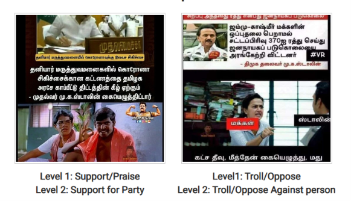
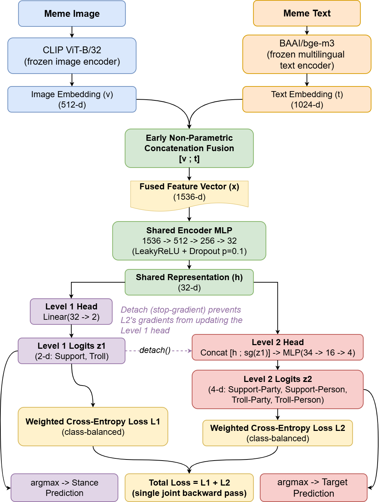

Our Paper **CPS Lab 1 @ MMLow 2026 Hierarchical Multimodal Classification of Tamil Political Memes via Logit-Conditioned Stance-Target Prediction** accepted at the **Fifth Workshop on Multimodal Machine Learning in Low-Resource Languages (MMLow 2026)**, co-located with **AACL-IJCNLP 2026**.

---

### Overview

Political memes combine textual and visual content to convey opinions, emotions, and political viewpoints. Understanding these memes requires analyzing both modalities simultaneously.

In this work, we propose a **hierarchical multimodal classification framework** for Tamil political memes. The framework first predicts the meme's stance and then utilizes the stance logits to improve target prediction through a logit-conditioned hierarchical architecture.

#### Sample Data

<p align="center">
  
</p>

---

### Methodology Diagram

<p align="center">
  
</p>

---

### Repository Structure

```text
CPS_Lab_1_MMLow_2026/
│
├── data/
├── results/
├── train.py
├── requirements.txt
├── architecture.png
├── data_sample.png
├── .gitignore
└── README.md
```

---

### Environment Setup

#### Clone the Repository

```bash
git clone https://github.com/vishalprasad1912/CPS_Lab_1_MMLow_2026.git
cd CPS_Lab_1_MMLow_2026
```

#### Create Virtual Environment

```bash
python -m venv venv
```

#### Activate Environment

```bash
venv\Scripts\activate
```

#### Install Dependencies

```bash
pip install -r requirements.txt
```

---

### Reproducing Results (Quick Run)

```bash
python -m train.py
```
---

### Acknowledgements

This work was carried out at **CPS Lab** and accepted as a poster presentation at **MMLow 2026**, the Fifth Workshop on Multimodal Machine Learning in Low-Resource Languages, co-located with **AACL-IJCNLP 2026**.

Our system achieved **3rd Rank in the Shared Task**, demonstrating the effectiveness of hierarchical multimodal learning and logit-conditioned prediction for Tamil political meme classification.

---

### Contact

For questions regarding this work, please open an issue in this repository or mail me at researchwithvishal[at]gmail[dot]com.
